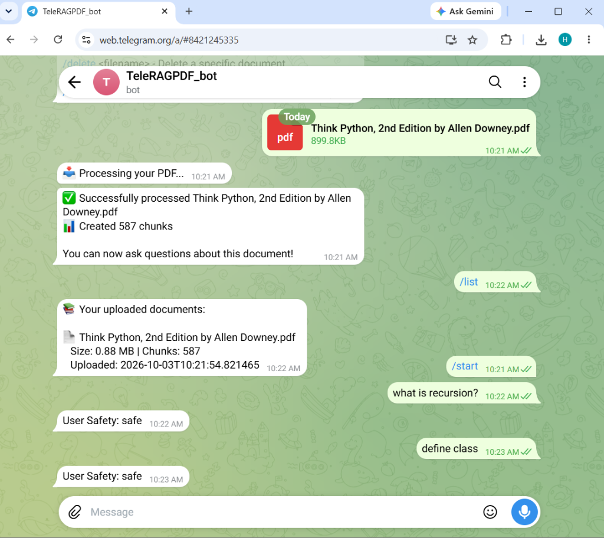

# TeleRAG

A lightweight Telegram bot for grounded question answering over PDF documents, running on local embeddings without external vector databases.

[](https://www.python.org/)
[](LICENSE)
[](https://github.com/himani-2-git/TeleRAG/actions/workflows/ci.yml)


---

## What It Does

• Ingests PDF documents via direct Telegram file uploads or public web links with multi-hop redirect verification.  
• Retrieves relevant passages using local bi-encoder embeddings and BM25 lexical search merged with Reciprocal Rank Fusion ($k=60$), with optional cross-encoder reranking.  
• Generates answers using an instruction-tuned LLM via OpenRouter and appends a verified Sources footer citing retrieved physical page numbers.

Retrieval was evaluated on a 70-question set over *Think Python 2e*, a smaller synthetic fixture set runs in CI to guard against regressions, and a Sources footer lists the retrieved pages for each answer.

---

## Screenshot

  
*(Screenshot placeholder: add your Telegram conversation screenshot at `docs/screenshots/telegram-answer.png`)*

---

## Why I Built It & What I Learned

I built TeleRAG to understand how a production-style RAG pipeline behaves end-to-end without relying on managed vector database services or opaque framework abstractions. Building this project taught me that chunk boundaries frequently split physical pages—causing citation errors unless tracked as intervals—and that combining BM25 with dense retrieval via Reciprocal Rank Fusion provides a practical hedge against vocabulary mismatch. Measuring each change against a verified 70-question golden set showed that dense and hybrid differ by only 1–2 questions on a 50-question set (within noise), whereas the real precision jump came from cross-encoder reranking at the cost of CPU inference latency.

---

## Measured Retrieval Results

All benchmarks below are measured on an Intel i5 CPU using `eval/run_eval.py` against *Think Python 2e* (582 chunks, ~1000 characters, 200 character overlap) and a verified golden dataset of 70 queries: 50 answerable questions spanning every chapter, 10 easy unanswerable off-topic questions (`u01`–`u10`), and 10 hard unanswerable programming questions (`u11`–`u20`, verified 100% absent from the text).

Metrics are reported under both **Span** (retrieved chunk's `[page_start, page_end]` interval overlaps the target page) and **Strict** (chunk strictly starts on target page):

| Strategy | Mode | Hit@1 (Span) | Hit@5 (Span) | MRR (Span) | Hit@1 (Strict) | Hit@5 (Strict) | MRR (Strict) | Easy Abstention | Hard Abstention | Mean Latency |
| :--- | :--- | :---: | :---: | :---: | :---: | :---: | :---: | :---: | :---: | :---: |
| **Baseline Dense** | `all-MiniLM-L6-v2` | 66.0% (33/50) | **100.0%** (50/50) | 0.7897 | 46.0% (23/50) | 90.0% (45/50) | 0.6243 | **100%** (10/10) | 0.0% (0/10) | **56.9 ms** |
| **Hybrid (Default)** | BM25 + Dense RRF ($k=60$) | 70.0% (35/50) | 96.0% (48/50) | 0.8073 | 52.0% (26/50) | 84.0% (42/50) | 0.6490 | **100%** (10/10) | 0.0% (0/10) | 57.8 ms |
| **Hybrid + Reranker** | Cross-Encoder MiniLM | **76.0%** (38/50) | 98.0% (49/50) | **0.8507** | **62.0%** (31/50) | **92.0%** (46/50) | **0.7323** | **100%** (10/10) | 0.0% (0/10) | 2,020.6 ms |

### Key Empirical Findings
1. **Hybrid vs. Dense Baseline**: Dense and hybrid differ by 1-2 questions on a 50-question set and are within noise; the measurable gain comes from the reranker (hit@1 66% -> 76%, MRR 0.79 -> 0.85, at ~2 s/query on CPU).
2. **Cross-Encoder Reranking (+10.0 pp Hit@1 Span, +16.0 pp Strict)**: Running `cross-encoder/ms-marco-MiniLM-L-6-v2` over top-20 hybrid candidates yields the strongest retrieval ranking (MRR 0.8507), trading ~2s of CPU latency for joint query-passage attention.
3. **Semantic Invariant & Hard Negative Failure**: Bi-encoders score 100% abstention on completely off-topic queries (scores < 0.22), but fail on out-of-scope in-domain queries (e.g. `asyncio`, `dataclass` score 0.35–0.48). This motivated our stratified dev/test abstention experiment below.

### Dev/Test Abstention Experiment
Using a balanced, stratified split (`eval/split.json`, seed=42; 35 DEV, 35 TEST; 25 answerable, 5 easy unanswerable, 5 hard unanswerable each), we evaluated an optional Cross-Encoder top-1 score gate ($T = -2.80$, tuned strictly on DEV) versus the production dense cosine threshold (0.3):

| Gatekeeper Strategy | Split | Answerable Recall | Easy Abstention | Hard Abstention | Decision Rule Outcome |
| :--- | :--- | :---: | :---: | :---: | :--- |
| **Dense Cosine (0.3)** | TEST (N=35) | **100.0%** (25/25) | **100.0%** (5/5) | 0.0% (0/5) | Production baseline |
| **Cross-Encoder ($T=-2.80$)**| TEST (N=35) | **100.0%** (25/25) | **100.0%** (5/5) | **40.0%** (2/5) | Rejects 2/5 hard negatives with 0/25 (0.0%) recall loss |

*Limitations of the experiment*: While the cross-encoder gate rejected 2/5 hard negatives without penalizing answerable recall on TEST, the dev-tuned threshold may be overfit to the dev sample, the test sample size is small (5 hard test queries), and cross-encoder inference adds ~2s query latency on CPU. Dense cosine gating remains the default gatekeeper, with hybrid and reranking configurable via `RETRIEVAL_MODE`.

---

## System Architecture

```
User (Telegram Client)
         │
         │  (HTTPS Telegram Bot API)
         ▼
┌────────────────────────────────────────────────────────┐
│             BotHandlers (Telegram Interface)           │
│  - User session & tenant isolation                     │
│  - Multi-hop SSRF validation & streaming limits        │
│  - Command routing: /start, /list, /delete, /clear     │
└──────────────┬──────────────────────────┬──────────────┘
               │                          │
      [Document Upload]             [User Question]
               │                          │
               ▼                          ▼
┌──────────────────────────────┐ ┌─────────────────────────────────────────┐
│     Page-Aware Ingestion     │ │            Retrieval Pipeline           │
│  - PDFProcessor (per-page)   │ │  - EmbeddingGenerator (all-MiniLM-L6)   │
│  - TextChunker (1000/200)    │ │  - Sparse BM25Okapi Indexing            │
│  - Dense EmbeddingGenerator  │ │  - Reciprocal Rank Fusion (RRF k=60)    │
│  - SQLite (page_start/end)   │ │  - Cross-Encoder Reranker (optional)    │
└──────────────┬───────────────┘ └──────────────┬──────────────────────────┘
               │                                │
               ▼                                ▼
┌──────────────────────────────┐ ┌─────────────────────────────────────────┐
│        DocumentStore         │ │            OpenRouter Client            │
│  - SQLite (Metadata & chunks)│ │  - Page citation context assembly       │
│  - JSON per-document vectors │ │  - Grounded answer generation           │
└──────────────────────────────┘ └──────────────┬──────────────────────────┘
                                                │
                                                ▼
                                    Telegram Answer Output
                                    + Verified Sources Footer
```

---

## Features

### 1. Document Ingestion & URL Fetching
* **Direct File Upload**: Upload local PDF documents up to 20 MB directly through Telegram.
* **URL-Based Ingestion**: Supply remote PDF web links with manual multi-hop redirect validation (up to 3 hops).
* **SSRF Defense**: Inspects each redirect hop and blocks private RFC1918 subnets (`10.0.0.0/8`, `192.168.0.0/16`, `172.16.0.0/12`), loopback (`127.0.0.1`), and cloud metadata addresses (`169.254.169.254`).
* **Streaming Byte Bounds**: Enforces `MAX_FILE_SIZE_MB` chunk-by-chunk during streaming to prevent chunked-transfer memory exhaustion.

### 2. Page-Aware Chunking & Citations
* **Boundary-Aware Text Extraction**: Extracts text per physical page and tracks chunk boundary intervals (`page_start`, `page_end`).
* **Sliding-Window Chunking**: Character chunk size (`CHUNK_SIZE=1000`) and overlap (`CHUNK_OVERLAP=200`) with backward-compatible SQLite schema migrations.
* **Page-Level In-Text Citations**: Context formatted as `[<filename>, p. <page>]` instructing the LLM to cite page locations.
* **Programmatic Source Verification**: Responses automatically append a verified Sources footer extracted directly from retrieved database chunks.

### 3. Multi-Stage Retrieval
* **Local Bi-Encoder Model**: Generates 384-dimensional dense vectors using `sentence-transformers/all-MiniLM-L6-v2` locally on host CPU.
* **Lexical BM25 Indexing**: In-memory `rank-bm25` index built over chunk tokens for exact term matching.
* **Reciprocal Rank Fusion (RRF)**: Merges dense semantic and BM25 rank lists ($k=60$) without requiring score calibration.
* **Cross-Encoder Reranking**: Optional deep re-ordering using `cross-encoder/ms-marco-MiniLM-L-6-v2`.
* **Relevance Cutoff Gatekeeper**: Enforces a dense cosine threshold (`SIMILARITY_THRESHOLD=0.3`) before calling the LLM. If no chunk meets the threshold, the bot abstains. This reduces answers not supported by the document; does not eliminate hallucination.

### 4. LLM Generation via OpenRouter
* **Model Selection**: Connected to OpenRouter API. Free model names change often; pick a model marked free there and set OPENROUTER_MODEL: https://openrouter.ai/models
* **Grounded Prompts**: Dynamically compiles top-$k$ passages into concise prompts with explicit refusal instructions.

### 5. Multi-User Isolation & Session Control
* **Tenant Isolation**: SQLite metadata and chunk records are indexed and scoped by Telegram `user_id`. Users can only query and manage their own documents.
* **Foreign Key Cascades**: SQLite database enforces `PRAGMA foreign_keys = ON`. Deleting a document removes associated chunk vectors and disk files.

---

## Quick Start

### 1. Prerequisites & Environment
```bash
python --version   # Must be Python 3.10, 3.11, or 3.12
python -m venv .venv
.\.venv\Scripts\activate   # Windows (or source .venv/bin/activate on Linux)
pip install -r requirements.txt -r requirements-dev.txt
```

> [!NOTE]
> On the first run, the embedding model (`all-MiniLM-L6-v2`, ~90 MB) is downloaded and cached automatically from Hugging Face. This requires an active internet connection once; subsequent runs execute completely offline on local CPU.

### 2. Configure Environment (`.env`)
```bash
cp .env.example .env
```
Fill in your credentials in `.env`:
```ini
TELEGRAM_BOT_TOKEN=your_telegram_bot_token_from_botfather
OPENROUTER_API_KEY=your_openrouter_api_key
OPENROUTER_MODEL=qwen/qwen3.8-27b:free
RETRIEVAL_MODE=hybrid
```

### 3. Verify & Run Test Suite
```bash
# Execute unit test suite (all tests should pass)
python -m unittest discover tests

# Launch the bot
python main.py
```

---

## Telegram Commands

| Command | Action | Description |
| :--- | :--- | :--- |
| `/start` | Bot Introduction | Sends a welcome overview and basic instructions. |
| `/help` | Detailed Help | Explains document upload options and question syntax. |
| `/list` | Show Documents | Lists all active documents in your library with file sizes and chunk counts. |
| `/delete <filename>` | Delete Specific File | Deletes a document, its database chunks, and its vector embeddings. |
| `/clear` | Wipe Library | Removes all uploaded documents and embeddings for your user account. |

---

## Evaluation

TeleRAG includes a reproducible evaluation harness:

```bash
# Evaluate baseline dense retrieval on Think Python 2e (70 questions)
python eval/run_eval.py --mode dense --pdf eval/fixtures/book.pdf --golden eval/golden.json --out eval/results/baseline.json

# Evaluate hybrid BM25 + dense retrieval
python eval/run_eval.py --mode hybrid --pdf eval/fixtures/book.pdf --golden eval/golden.json --out eval/results/hybrid.json

# Evaluate hybrid retrieval + cross-encoder reranking
python eval/run_eval.py --mode hybrid_rerank --pdf eval/fixtures/book.pdf --golden eval/golden.json --out eval/results/hybrid_rerank.json

# Run CI quality gate on synthetic 8-page fixture
python eval/run_eval.py --mode hybrid --pdf eval/fixtures/ci_fixture.pdf --golden eval/golden_ci.json --thresholds eval/thresholds.json
```

---

## Security

* **SSRF Protection**: URL ingestion validates schemes (`http`/`https`) and resolves target IP addresses via `socket.getaddrinfo()` to block private RFC1918 subnets, loopback (`127.0.0.1`), and cloud metadata (`169.254.169.254`). Each hop in a redirect chain (up to 3 hops) is validated separately with `allow_redirects=False`.
* **Streaming Byte Limits**: Downloads are consumed in 8 KB streaming chunks. Sockets are aborted immediately if transferred bytes exceed `MAX_FILE_SIZE_MB`, guarding against unbounded downloads where `Content-Length` is omitted.
* **Per-User Scoping**: All database queries filter on `WHERE documents.user_id = ?` to partition document and chunk access by Telegram user.
* **Cascade Deletion**: SQLite enforces `PRAGMA foreign_keys = ON` with `ON DELETE CASCADE`. Removing a document cleanly removes its associated chunk metadata and vector files.

---

## Limitations

1. **Hallucination Reduction, Not Elimination**: The relevance threshold ($\tau = 0.3$) and prompt instructions reduce unsupported answers, but an LLM can still misinterpret retrieved context or hallucinate nuances.
2. **Hard Negative Abstention**: While bi-encoder cosine gating stops 100% of off-topic queries, it does not stop in-domain unanswerable queries (e.g., asking about `asyncio` on a basic Python textbook), where chunks score 0.35–0.48. The cross-encoder threshold experiment rejected 2/5 on test, but was tuned on a small sample.
3. **Cross-Encoder Latency**: Reranking improves Hit@1 by +10.0 pp but increases query latency to ~2s on CPU compared to ~57 ms for dense or hybrid retrieval.
4. **SSRF DNS Rebinding**: URL validation checks resolved IPs before request dispatch, but standard `requests.get()` does not pin resolved IP addresses to the socket connection, leaving a theoretical window for DNS rebinding attacks.
5. **Text-Only PDF Extraction**: Scanned documents or image-only PDFs without an embedded OCR text stream cannot be extracted by `PyPDF2`.
6. **Local Single-Host Storage**: SQLite and JSON embedding files reside unencrypted on the local filesystem, suitable for personal or small-team use rather than untrusted multi-tenant host environments.

---

## Project Structure

```
TeleRAG/
├── .github/
│   └── workflows/
│       └── ci.yml              # GitHub Actions CI quality gate
├── eval/
│   ├── fixtures/               # Evaluation PDFs (ci_fixture.pdf synthetic document)
│   ├── golden.json             # 70-question verified golden dataset (Think Python 2e)
│   ├── golden_ci.json          # 15-question synthetic CI golden dataset
│   ├── split.json              # Stratified DEV/TEST split (seed 42)
│   ├── thresholds.json         # Regression thresholds for CI quality gate
│   ├── run_eval.py             # Evaluation harness (dense, hybrid, hybrid_rerank)
│   ├── run_abstention_experiment.py # Dev/Test abstention gate experiment
│   └── results/                # Measured benchmark outputs (JSON)
│       ├── baseline.json       # Dense baseline metrics
│       ├── hybrid.json         # BM25 + Dense RRF metrics
│       ├── hybrid_rerank.json  # Cross-encoder reranked metrics
│       ├── ci_eval.json        # Synthetic CI fixture metrics
│       └── abstention_experiment.json # Stratified dev/test gate comparison
├── docs/
│   ├── design-decisions.md     # Architecture decisions and trade-offs log
│   └── screenshots/            # UI screenshots (telegram-answer.png)
├── main.py                     # Bot entry point and lifecycle manager
├── requirements.txt            # Pinned production dependencies
├── requirements-dev.txt        # Development & evaluation dependencies (fpdf2)
├── .env.example                # Configuration template
├── .gitignore                  # Git exclusion rules
├── INSTRUCTIONS.md             # Complete installation, configuration & user manual
├── LICENSE                     # Standard MIT License
├── README.md                   # Repository features & empirical evaluation
├── TECHNICAL_REPORT.md         # Detailed technical engineering report
│
├── src/
│   ├── config.py               # Central environment variable configuration
│   ├── bot/
│   │   ├── handlers.py         # Telegram message & command handlers, SSRF checks, source footer
│   │   └── __init__.py
│   ├── processors/
│   │   ├── pdf_processor.py    # Page-aware extraction, validation
│   │   ├── text_chunker.py     # Sliding-window chunker with page bounds
│   │   └── __init__.py
│   ├── rag/
│   │   ├── embeddings.py       # SentenceTransformers embedding generation
│   │   ├── hybrid.py           # BM25 + dense Reciprocal Rank Fusion
│   │   ├── reranker.py         # CrossEncoder candidate reranking
│   │   ├── retriever.py        # Routing retriever & page citation context formatting
│   │   ├── openrouter_client.py# OpenRouter HTTP API client & response parsing
│   │   └── __init__.py
│   └── storage/
│       ├── database.py         # SQLite schema, page columns & migrations
│       ├── document_store.py   # Document ingestion, vector storage & retrieval
│       └── __init__.py
│
└── tests/                      # Automated unit test suite
    ├── test_citations.py       # Tests for page citations & source footers
    ├── test_handlers.py        # Tests for SSRF defense, redirects, and streaming limits
    ├── test_hybrid.py          # Tests for BM25, RRF fusion, and abstention invariant
    ├── test_pdf_processor.py   # Tests for extraction, chunking, and page boundaries
    ├── test_rag.py             # Tests for embeddings, cosine search, 404 handling, thresholds
    ├── test_reranker.py        # Tests for cross-encoder reranking order and scores
    └── test_storage.py         # Tests for database CRUD, page migrations, and cascades
```

---

## License

This project is licensed under the MIT License. See the [LICENSE](LICENSE) file for details.
