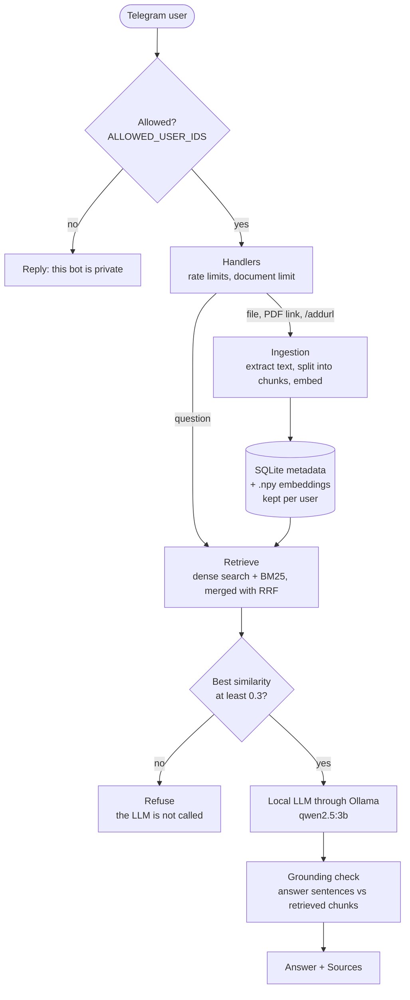

# TeleRAG

A Telegram bot that answers questions about documents you send it. You upload a PDF, a Markdown or text file, a PDF link or a web page, then ask questions in the chat. The bot finds the most relevant passages, asks a small language model that runs on your own computer to answer from them, and lists the pages it used as sources.

The language model (through [Ollama](https://ollama.com)) and the embedding model both run locally on a CPU. Your messages and files still travel through Telegram, as with any Telegram bot, but nothing is sent to an AI service unless you point the bot at one yourself.

[](https://github.com/himani-2-git/TeleRAG/actions/workflows/ci.yml)
[](https://www.python.org/)
[](LICENSE)

**Status:** a personal learning project, developed and tested on one Windows 11 laptop (Intel i5, 16 GB RAM, no GPU) with `qwen2.5:3b`. A 3-billion-parameter model is small: it makes mistakes even when it is shown the right text (see [Known limitations](#known-limitations)). The Docker setup is covered by tests of its files and by `docker compose config`, but the full stack has not been run end to end yet.

## Contents

- [What it does](#what-it-does)
- [How it is built](#how-it-is-built)
- [Setup on Windows](#setup-on-windows)
- [Setup with Docker](#setup-with-docker)
- [Using the bot](#using-the-bot)
- [Configuration](#configuration)
- [How retrieval, answering and grounding work](#how-retrieval-answering-and-grounding-work)
- [Evaluation results](#evaluation-results)
- [Security and privacy measures](#security-and-privacy-measures)
- [Known limitations](#known-limitations)
- [Development](#development)
- [More documentation](#more-documentation)

## What it does

- **Reads** PDF files, Markdown (`.md`), plain text (`.txt`), direct PDF links and static web pages (`/addurl`).
- **Answers** from your documents only, and says so when it cannot find the answer instead of guessing.
- **Cites** the pages (or sections) that support the answer.
- **Keeps users apart.** Each Telegram user has their own documents, and nobody else's text can appear in their answers.
- **Protects itself** with an optional allowlist, rate limits, a limit on stored documents, and checks on every URL it downloads.

What it does not do: read scanned PDFs (there is no OCR), run JavaScript on web pages, or use a GPU.

## How it is built



| Part | Where | What it does |
| :--- | :--- | :--- |
| Telegram layer | `src/bot/` | Commands, uploads, questions, the allowlist, rate limits, `/status`. |
| Ingestion | `src/processors/` | Text extraction (`pypdf`, Markdown, `BeautifulSoup`), chunking, URL safety checks. |
| Retrieval and answering | `src/rag/` | Embeddings, BM25, fusion, optional reranker, prompt, LLM client, grounding check. |
| Storage | `src/storage/` | SQLite for documents and chunks, NumPy files for embeddings. Optional Chroma backend. |
| Setup and checks | `main.py`, `src/config.py`, `src/startup.py` | Reads and validates settings, checks the LLM server, starts the bot. |
| Evaluation | `eval/` | Scripts and result files used for the numbers below. |

Two optional extras exist: `VECTOR_BACKEND=chroma` and `ORCHESTRATOR=langgraph`. Both are off by default and need an extra `pip install` (see `requirements/`).

## Setup on Windows

You need Windows 10 or 11, Python 3.10 to 3.12, [Git](https://git-scm.com/), and [Ollama](https://ollama.com/download). Keep a few GB of disk space free for the models and libraries.

**1. Get the code and install the libraries** (PowerShell):

```powershell
git clone https://github.com/himani-2-git/TeleRAG.git
cd TeleRAG
py -3.12 -m venv .venv
.venv\Scripts\Activate.ps1
pip install -r requirements/base.txt -r requirements/dev.txt
```

If PowerShell refuses to run the activation script, run `Set-ExecutionPolicy -Scope CurrentUser RemoteSigned` once, then try again.

**2. Download the language model:**

```powershell
ollama pull qwen2.5:3b
```

**3. Create a Telegram bot.** Open [@BotFather](https://t.me/BotFather) in Telegram, send `/newbot`, and copy the token it gives you.

**4. Configure the bot:**

```powershell
Copy-Item .env.example .env
notepad .env
```

Set `TELEGRAM_BOT_TOKEN`. To make the bot private, also set `ALLOWED_USER_IDS` to your own Telegram ID (send any message to [@userinfobot](https://t.me/userinfobot) to find it). If you want to use `/status`, set `ADMIN_USER_IDS` too. Without an allowlist, anyone who finds your bot can use it.

**5. Start it:**

```powershell
python main.py
```

The first start downloads the embedding model (about 90 MB). At startup the bot checks its settings, the Ollama server and the model, and stops with a message that says what to fix if something is wrong. When you see `Bot is ready! Starting polling...`, open your bot in Telegram. Press `Ctrl + C` to stop it. The bot finishes the answer it is writing first.

**Troubleshooting**

- *"Cannot reach the LLM server"*: start Ollama and check that `LLM_BASE_URL` is `http://localhost:11434/v1`.
- *"does not know the model"*: run `ollama pull qwen2.5:3b` (or the model named in `LLM_MODEL`).
- *`WinError 4551` when PyTorch loads*: Windows application control blocked a PyTorch file. It happened once on the author's laptop and went away on retry; the cause was not found.
- Answers take 10 to 20 seconds on a laptop CPU. That is normal for this setup. Close other heavy programs if it is much slower.

## Setup with Docker

This runs the bot and its own Ollama server in containers, on CPU. You need [Docker Desktop](https://www.docker.com/products/docker-desktop/) for Windows (WSL 2 backend). In Docker Desktop, allow about 6 GB of memory (Settings, then Resources).

```powershell
Copy-Item .env.example .env       # then set TELEGRAM_BOT_TOKEN in .env
docker compose up -d --build
docker compose logs -f bot
```

The first start builds the bot image (PyTorch for CPU and the embedding model are downloaded) and downloads the language model (about 1.8 GB) into a Docker volume. After that, starting is quick. The containers use these volumes: `ollama_models` (the language model), `bot_data` (documents, embeddings, database) and `bot_logs`.

```powershell
docker compose stop        # stop, keep everything
docker compose down        # remove the containers, keep the volumes (your data)
docker compose down -v     # remove the containers AND all data, including the model
```

How it is set up: the bot image is based on `python:3.12-slim`, installs the CPU build of PyTorch with fixed library versions, and runs as a normal user, not root. The bot waits until Ollama is healthy. Ollama is not reachable from outside Docker. The `.env` file is read by Docker Compose and is never copied into the image.

## Using the bot

Send a file or a link, wait for the "Successfully processed" message, then ask questions.

| You send | What happens |
| :--- | :--- |
| A PDF, `.md` or `.txt` file (up to 20 MB) | The file is read, split into chunks and stored for you. |
| A direct link to a PDF | The bot downloads it (with safety checks) and stores it. |
| `/addurl <url>` | The bot downloads a static web page and stores its text. |
| A question in plain words | The bot answers from your documents and lists the sources. |
| A request such as "summarize this document" | The bot answers from 8 chunks spread over the whole document. |
| `/list` | Shows your documents. |
| `/delete <number or part of the name>` | Deletes one document. |
| `/clear` | Deletes all your documents. |
| `/status` (alias `/health`) | Admins only: checks the database, the embedding model and the LLM server. |
| `/help` | Shows this list in the chat. |

Uploaded files are not kept. The bot stores only the extracted text chunks and their embeddings.

## Configuration

All settings are environment variables, read from `.env` (copy `.env.example`). The bot checks them at startup and stops with a list of every problem it finds. Settings that are a number of seconds, bytes or documents accept `0` where the table says so.

| Variable | Default | Description |
| :--- | :--- | :--- |
| `TELEGRAM_BOT_TOKEN` | none (required) | Token from @BotFather. |
| `LLM_BASE_URL` | `http://localhost:11434/v1` | OpenAI-compatible chat endpoint. Ollama by default. |
| `LLM_MODEL` | `qwen2.5:3b` | Model name on that server. |
| `LLM_API_KEY` | empty | Needed only for remote services. Local and internal hosts (such as `ollama` in Docker) need no key. |
| `LLM_MAX_TOKENS` | `1024` | Longest answer the model may write. |
| `LLM_TIMEOUT_SECONDS` | `120` | How long to wait for one LLM request. |
| `LLM_MAX_TOTAL_SECONDS` | `180` | Upper limit for one question, counting all retries and pauses. |
| `MAX_RETRIES` | `3` | Attempts for one LLM request. |
| `RETRY_DELAY` | `1.0` | Pause before the first retry, in seconds. It doubles each time. |
| `EMBEDDING_MODEL` | `all-MiniLM-L6-v2` | Sentence-transformers model used for search. |
| `RETRIEVAL_MODE` | `hybrid` | `dense`, `hybrid` or `hybrid_rerank`. |
| `TOP_K_RESULTS` | `2` | Chunks given to the LLM as context. |
| `SIMILARITY_THRESHOLD` | `0.3` | Below this best cosine similarity the bot refuses without calling the LLM. |
| `CHUNK_SIZE` | `1000` | Characters per chunk. |
| `CHUNK_OVERLAP` | `200` | Characters shared by neighbouring chunks. |
| `MAX_FILE_SIZE_MB` | `20` | Largest accepted file. |
| `MAX_CHUNKS_PER_DOCUMENT` | `5000` | Largest accepted document, in chunks. |
| `PROMPT_VERSION` | `v1` | Which `prompts/<version>.yaml` to use. |
| `GROUNDING_THRESHOLD` | `0.45` | Cosine similarity an answer sentence needs to count as supported by a chunk. |
| `GROUNDING_ENFORCE` | `false` | If `true`, refuse answers where fewer than `GROUNDING_MIN_COVERAGE` of the sentences are supported. |
| `GROUNDING_MIN_COVERAGE` | `0.5` | Share of supported sentences required when enforcing. |
| `ALLOWED_USER_IDS` | empty | Comma-separated Telegram IDs. If set, everyone else gets "this bot is private". Empty means open to all. |
| `ADMIN_USER_IDS` | empty | IDs allowed to use `/status`. If empty, `ALLOWED_USER_IDS` are admins. If both are empty, `/status` is off. |
| `QUESTION_RATE_LIMIT` | `5` | Questions per user per window. `0` means no limit. |
| `UPLOAD_RATE_LIMIT` | `3` | Uploads per user per window (files, PDF links, `/addurl`). `0` means no limit. |
| `RATE_LIMIT_WINDOW_SECONDS` | `60` | Length of the rate-limit window. |
| `MAX_DOCUMENTS_PER_USER` | `20` | Stored documents per user. `0` means no limit. |
| `CONCURRENT_UPDATES` | `16` | How many messages are processed at the same time. |
| `DATABASE_PATH` | `data/documents.db` | SQLite file. |
| `EMBEDDINGS_PATH` | `data/embeddings` | Folder for embedding files. |
| `VECTOR_BACKEND` | `numpy` | `numpy` or `chroma`. |
| `CHROMA_PATH` | `data/chroma` | Folder used when the backend is `chroma`. |
| `ORCHESTRATOR` | `plain` | `plain` or `langgraph`. |
| `LOG_LEVEL` | `INFO` | `DEBUG`, `INFO`, `WARNING`, `ERROR` or `CRITICAL`. |
| `LOG_FILE` | `logs/bot.log` | Log file. Each line is one JSON object and carries a request ID. |
| `LOG_MAX_BYTES` | `5000000` | Size at which the log file is rotated. |
| `LOG_BACKUP_COUNT` | `3` | Rotated log files to keep. |

## How retrieval, answering and grounding work

**Ingestion.** Text is extracted (page by page for PDFs, by heading for Markdown, from the page body for web pages) and cut into chunks of about 1,000 characters that overlap by 200. Each chunk remembers the pages it covers, which is what makes page citations possible. Every chunk is turned into a 384-number vector by `all-MiniLM-L6-v2`. The vectors of a document are saved in one `.npy` file; the text and metadata go into SQLite.

**Retrieval.** For a question, the bot loads the asking user's chunks and does two searches over them:

1. *Dense search*: cosine similarity between the question vector and every chunk vector.
2. *BM25*: a keyword search that is good at exact terms such as function names.

The two rankings are merged with Reciprocal Rank Fusion (each chunk scores the sum of `1 / (60 + rank)` over both lists), and the top `TOP_K_RESULTS` chunks are kept. If even the best dense similarity is below `SIMILARITY_THRESHOLD` (0.3), the bot refuses at once and never calls the LLM. With `RETRIEVAL_MODE=hybrid_rerank`, the top 20 chunks are first re-scored by a cross-encoder (`ms-marco-MiniLM-L-6-v2`), which is more accurate but adds about 2 seconds per question on this CPU. The BM25 index is cached per user (at most 8 indexes) and dropped when that user adds or deletes a document.

**Answering.** The chunks go into the prompt in `prompts/v1.yaml`, which tells the model to use only that text, to cite `[file, p. N]`, to keep to 150 words, and to reply with the single word `INSUFFICIENT_CONTEXT` when the text does not contain the answer. The bot then classifies the reply sentence by sentence:

- only refusal sentences ("the document does not mention...") give the standard refusal message;
- an answer that mixes real content with a refusal sentence is kept, if at least one of its other sentences is supported by the chunks (see below). The raw marker is removed;
- a reply of fewer than three words is retried once.

A request to summarize the whole document skips retrieval and uses 8 chunks spread evenly from the start to the end. A question that merely contains the word "summary", such as "summarize the Raft algorithm", is answered like any other question.

**Grounding check.** After the model answers, the bot cuts the answer into sentences (leaving out footers and refusal sentences), turns each sentence into a vector, and measures its cosine similarity to each retrieved chunk. A sentence counts as supported if its best similarity is at least `GROUNDING_THRESHOLD` (0.45). The result is used in three ways: the Sources footer lists only chunks that supported some sentence, an answer with no supported sentence gets the note "Could not verify this answer against the cited pages", and a mixed answer with no supported sentence is refused. With `GROUNDING_ENFORCE=true`, an answer where fewer than half of the sentences are supported is refused too.

This check is a similarity score. It is not a proof that an answer is true: a wrong sentence on the same topic as the chunk can pass, and a correct sentence in very different words can fail. It reduces unsupported answers; it does not remove them.

**Reliability.** Several users can be served at the same time; the LLM answers one question at a time. Each LLM call has a timeout, retries with growing pauses, and all attempts for one question together stay below `LLM_MAX_TOTAL_SECONDS`. Downloads have a total time limit. If something unexpected fails, the user sees a short friendly message and the details go to the log.

## Evaluation results

These numbers come from the scripts in `eval/` and the result files in `eval/results/`. They were measured on the laptop described at the top. The test set is small, so differences of a few percentage points are within noise.

**Retrieval on a real book.** *Think Python, 2nd edition* (582 chunks), 50 answerable questions that cover all chapters. "Hit@k" means a correct page appears in the top k chunks. A chunk counts if its page range overlaps the target page ("span" metric).

| Retrieval mode | Hit@1 | Hit@5 | MRR | Mean search time |
| :--- | :---: | :---: | :---: | :---: |
| Dense only | 66.0% (33/50) | 100.0% (50/50) | 0.790 | 57 ms |
| Hybrid (default) | 70.0% (35/50) | 96.0% (48/50) | 0.807 | 58 ms |
| Hybrid + reranker | 76.0% (38/50) | 98.0% (49/50) | 0.851 | 2,021 ms |

What this shows: hybrid and dense differ by one or two questions, which is within noise. The clear gain comes from the reranker (Hit@1 from 66% to 76%), at the cost of about 2 seconds per question. With the stricter "strict" metric (the chunk must start on the target page) all numbers are lower, for example 46%, 52% and 62% for Hit@1.

**Refusing questions that are not in the book.** 20 questions the book cannot answer. 10 were off-topic (cooking, sport) and all 10 were refused (100%). 10 were Python questions the book does not cover (for example `asyncio`); **none** was refused (0%), because they look similar to the book's content. This is the main weakness of the similarity threshold. In a small experiment, a cross-encoder score gate (threshold tuned on a development half) refused 2 of 5 such questions on the held-out half without losing any answerable question. That sample is too small to trust, so the gate is not enabled.

**Synthetic CI fixture.** An 8-page generated document with 15 questions (12 answerable, 3 off-topic) is used as a regression test in CI: Hit@5 100% (12/12), MRR 1.0, all 3 off-topic questions refused. A second CI check confirms that reference answers are judged supported by the grounding check and that deliberately wrong answers are not.

**Speed of the language model.** On the 12 answerable and unanswerable questions of the CI fixture, `qwen2.5:3b` had a median answer time of 13.8 s (95th percentile 21.1 s); `llama3.2:3b` had 14.5 s and 20.9 s. Both answered all answerable questions and refused all unanswerable ones. This measures behavior and speed, not whether the answers are correct. Before switching to a 3B model, a 7B model took 10 to 20 minutes per answer on this laptop.

**Answer quality, checked by hand.** 16 questions asked through the bot about a 1,023-chunk Python textbook (answers took 23 to 116 seconds): 8 correct, 3 partly correct, 4 wrong or empty, 1 not checked. Both questions that were not in the document were refused, and both prompt-injection attempts were ignored. This was a small, informal test on an earlier version of the bot, so treat it as a rough impression, not a measurement.

**Faithfulness score (experimental).** An offline script scores how many answer sentences a natural-language-inference model finds entailed by the retrieved text. The mean for 20 answers was 0.535. This number must not be read as "46.5% hallucination". None of the judges I tried passed my own validation against known-good and known-bad answers: the default judge rejected 3 of 12 correct reference answers, and the other judges accepted a subtly wrong answer. The script therefore labels its verdict "NOT TRUSTWORTHY". The details are in [docs/evaluation.md](docs/evaluation.md).

**Reproduce.** The book PDF is not in the repository (copyright); download *Think Python 2e* (free) and save it as `eval/fixtures/book.pdf`.

```powershell
python eval/run_eval.py --mode hybrid_rerank --pdf eval/fixtures/book.pdf --golden eval/golden.json --out eval/results/hybrid_rerank.json
python eval/run_eval.py --mode hybrid --pdf eval/fixtures/ci_fixture.pdf --golden eval/golden_ci.json --thresholds eval/thresholds.json
python eval/run_grounding_gate.py --pdf eval/fixtures/ci_fixture.pdf --answers eval/fixtures/ci_answers.json --thresholds eval/thresholds.json
```

## Security and privacy measures

- **Who can use the bot.** Optional allowlist (`ALLOWED_USER_IDS`). It is checked in one place that runs before every other handler, so no command can skip it.
- **Separation of users.** The queries the bot uses to read documents and chunks are filtered by the Telegram user ID, and the search cache is keyed by user. (One unused helper in `src/storage/database.py`, `get_document_chunks`, takes a document ID without a user filter; no code calls it.) An earlier bug in that cache could show one user another user's text; it is fixed and covered by a regression test (see [docs/INTERVIEW_NOTES.md](docs/INTERVIEW_NOTES.md)).
- **Limits per user.** Questions and uploads are rate limited, and the number of stored documents is capped. Files are limited to 20 MB, documents to 5,000 chunks.
- **Downloads.** Only `http` and `https`. Addresses that resolve to private, loopback, link-local, multicast or reserved ranges, and the cloud metadata address, are refused. Redirects are followed by hand (at most 3) and every hop is checked again. Size caps and total time limits apply while streaming. **Known gap:** the address is checked and then looked up again when connecting, so an attacker who controls a DNS server could still redirect the download to a private address (DNS rebinding). Closing this needs IP pinning, which is not implemented. If the machine can reach private services, keep `ALLOWED_USER_IDS` set.
- **Uploads.** File names are cleaned (no path parts, no reserved Windows names). Encrypted PDFs and PDFs without text are rejected.
- **Logs.** The bot token, the LLM key and bearer tokens are removed from every log line. URLs are logged without query string or credentials. Document text, questions and answers are never logged, only their length. A test checks this with marker text.
- **Errors.** Users get short friendly messages. Stack traces go to the log file only.
- **Docker.** Runs as a non-root user, publishes no ports, keeps `.env` out of the image.
- **Prompt injection.** The prompt tells the model to use only the supplied text, and the manual test above had 2 of 2 injection attempts ignored. That is not a guarantee: instructions inside a document are still sent to the model.

Data is stored unencrypted on the machine that runs the bot.

## Known limitations

1. **A small model.** `qwen2.5:3b` sometimes gives wrong or muddled answers even when the right passage was retrieved (4 of 16 in the manual test). Check important answers against the cited pages.
2. **The grounding check is a similarity score** (see above). It reduces unsupported answers and does not remove them.
3. **Questions that look related but are not covered** are not refused (0 of 10 in the evaluation), because the check is a similarity threshold.
4. **Only 2 chunks are given to the model** by default. Questions that need information from several places in a document can be answered incompletely.
5. **Summaries are coarse.** They use 8 chunks spread over the document, not a step-by-step summary of a long book. With several documents, the 8 chunks are spread over all of them.
6. **One answer at a time.** Several users are served at once, but the LLM writes one answer at a time, so a busy bot makes users wait. On this CPU an answer takes roughly 10 to 120 seconds, depending on the document and the question.
7. **Single machine.** The bot only answers while it is running. State is in a local SQLite file and local files, there is no encryption at rest, and rate-limit counters reset when the bot restarts.
8. **Text only.** Scanned PDFs and images are not read. Web pages are fetched as static HTML.
9. **DNS rebinding gap** in URL checks (see Security).
10. **Evaluation size.** The retrieval benchmark covers one book and 50 questions, and the faithfulness judge is not trustworthy. The numbers show trends, not guarantees.
11. **Docker setup not yet run end to end** (see Status).

## Development

```powershell
python -m unittest discover tests      # more than 350 tests, under a minute
ruff check .
ruff format --check .
```

The tests do not need Ollama or Telegram. They use fake models and fake Telegram objects, except for a few that load the small embedding model. CI (`.github/workflows/ci.yml`) runs the linter, the tests and two quality gates on every push, for Python 3.10, 3.11 and 3.12. Some tests also guard the documentation: every setting must appear in this README and in `.env.example`, links must work, and a list of statements that were once wrong must not come back.

```text
main.py                  starts the bot
src/bot/                 Telegram handlers, rate limiter, /status checks
src/processors/          PDF, Markdown, web and chunking code
src/rag/                 retrieval, LLM client, prompts, grounding
src/storage/             SQLite and vector storage
prompts/                 versioned prompt files
eval/                    evaluation scripts, questions and results
tests/                   unit tests
Dockerfile, docker-compose.yml
```

## More documentation

- [Setup guide](docs/setup.md): installation details, commands, optional backends, troubleshooting.
- [Architecture](docs/architecture.md): components, the life of a question, storage, concurrency.
- [Design decisions](docs/design-decisions.md): why the main choices were made.
- [Evaluation report](docs/evaluation.md): all benchmark tables, ablations, judge validation.
- [Technical report](docs/technical-report.md): a longer write-up with formulas.
- [Interview notes](docs/INTERVIEW_NOTES.md): each component's design decision, alternatives, trade-offs and likely questions, plus the story of the cross-user leak bug.

## Why I built it

I wanted to learn what it takes to build a document question-answering bot I can actually trust, not one that only sounds confident. The most useful lesson was that measuring is harder than building. My first faithfulness score was a perfect 1.00 and I did not believe it, so I tested the judge with deliberately wrong answers and found it was too lenient; after trying several judges I still do not have one I trust, and this README says so. A second lesson came later: a review of my own code found a bug that showed one user another user's text, and fixing it meant changing how the cache was keyed, not just adding a check.

## License

MIT, see [LICENSE](LICENSE).
