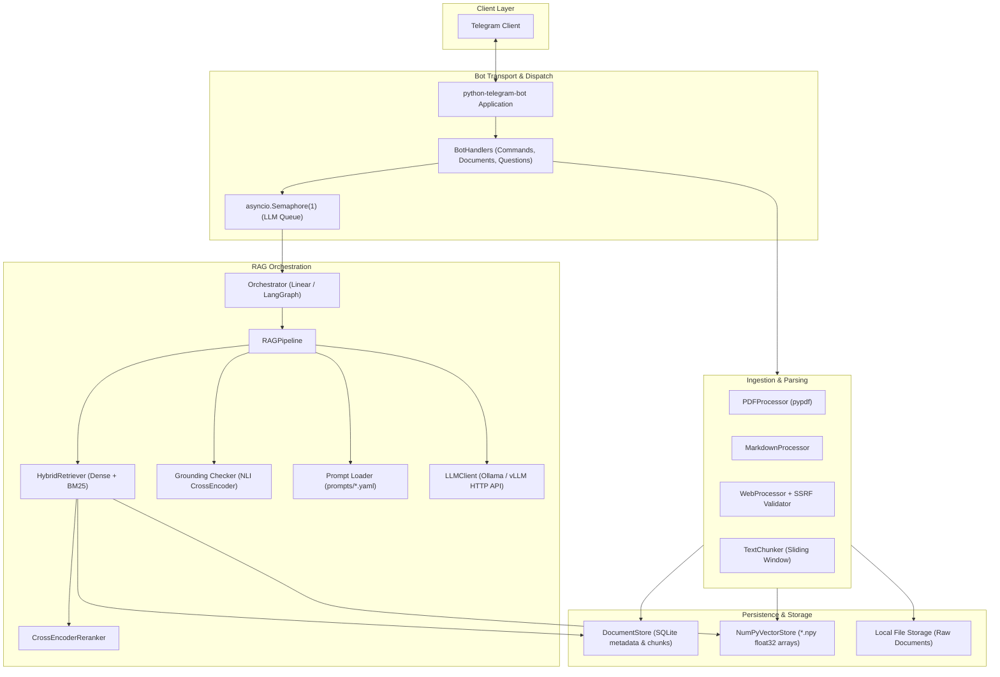
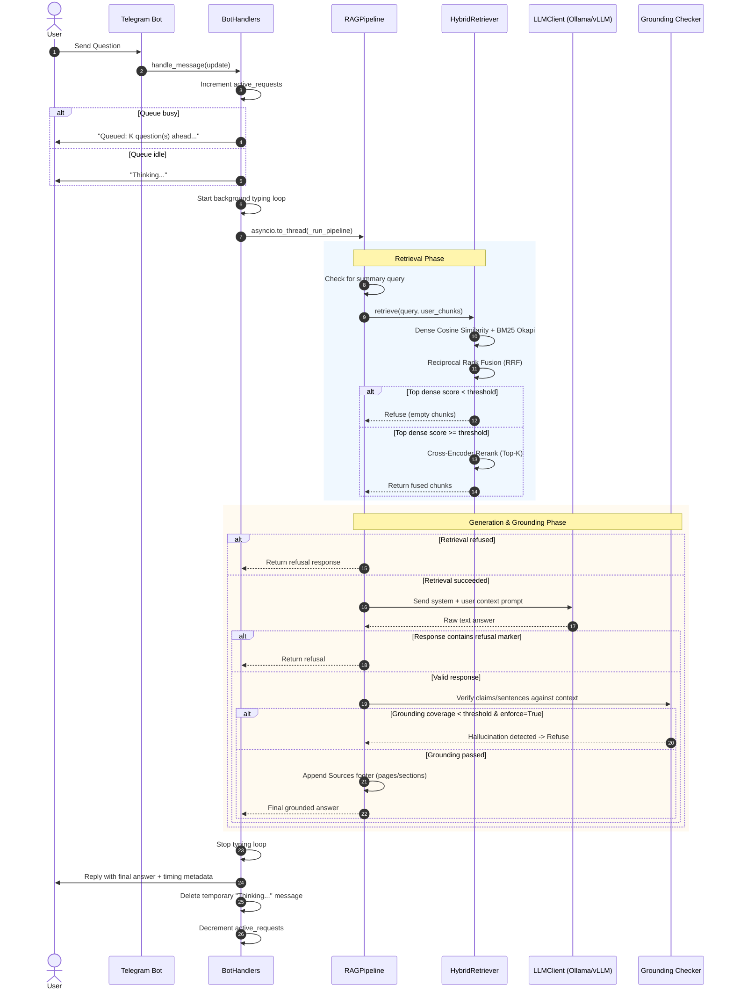

# TeleRAG System Architecture

This document describes the architectural design, component interactions, runtime request flow, storage model, configuration parameters, and known operational tradeoffs of TeleRAG.

---

## 1. Component Overview

TeleRAG is structured into decoupled subsystems covering Telegram transport, ingestion, hybrid retrieval, generation, grounding verification, and multi-tenant persistence.



### Subsystems

1. **Bot Transport (`src/bot/handlers/`)**:
   - Manages Telegram updates using `python-telegram-bot`.
   - Organised into mixins: `CommandHandlersMixin`, `DocumentHandlersMixin`, and `QuestionHandlersMixin`.
   - Protects the underlying model with an `asyncio.Semaphore(1)` queue to prevent local GPU/CPU thrashing.
   - Periodically emits chat typing actions while background inference executes in a dedicated worker thread via `asyncio.to_thread`.

2. **Ingestion Processors (`src/processors/`)**:
   - `pdf_processor.py`: Page-aware text extraction and validation via `pypdf`.
   - `markdown_processor.py`: Structural header-preserving parsing for markdown files.
   - `web_processor.py` & `pdf_fetcher.py`: SSRF-hardened document downloads, DNS pinning, private-IP blocklists, and size caps.
   - `text_chunker.py`: Configurable character chunking with overlap and page boundary tracking.

3. **Retrieval & Reranking (`src/rag/`)**:
   - `embeddings.py`: Generates dense representations using `sentence-transformers` (`all-MiniLM-L6-v2`).
   - `retriever.py`: Hybrid retrieval combining dense cosine similarity and BM25Okapi using Reciprocal Rank Fusion (RRF). Dense score thresholding enforces abstention when query similarity falls below `RETRIEVAL_THRESHOLD`.
   - `reranker.py`: Cross-encoder reranking (`ms-marco-MiniLM-L-6-v2`) with in-memory model caching.

4. **Generation & Verification (`src/rag/`)**:
   - `pipeline.py`: The single source of truth for RAG execution. Coordinates retrieval, prompt rendering, LLM completion, refusal classification, citation assembly, and post-generation grounding.
   - `grounding.py`: Sentence-level NLI entailment checking against retrieved context.
   - `llm_client.py`: Resilient HTTP client targeting Ollama or vLLM endpoints with exponential backoff and timeout handling.

---

## 2. Request Lifecycle

The diagram below details the end-to-end execution path for a user question:



---

## 3. Storage Layout & Caching

TeleRAG separates relational metadata from dense embedding matrices:

```
storage/
├── documents.db                 # SQLite 3 relational database
├── embeddings/                  # Per-document float32 embeddings
│   ├── <doc_id_1>.npy
│   └── <doc_id_2>.npy
└── raw/                         # Raw ingested files
    └── <user_id>/
        └── <filename>
```

### Relational Schema (`documents.db`)

1. **`documents`**:
   - `id`: Integer primary key.
   - `user_id`: Integer Telegram user identifier.
   - `filename`: Text filename or citation label.
   - `file_path`: Filesystem path to raw content.
   - `file_size`: File size in bytes.
   - `chunk_count`: Total chunks generated.
   - `source_type`: `pdf`, `markdown`, `text`, or `web`.
   - `upload_date`: ISO 8601 timestamp.

2. **`chunks`**:
   - `id`: Integer primary key.
   - `document_id`: Foreign key referencing `documents(id)`.
   - `chunk_index`: Integer zero-based sequence index.
   - `content`: Extracted text content.
   - `char_count`: Character length.
   - `page`: Page number (1-based, nullable for non-PDFs).
   - `page_start` / `page_end`: Span boundaries.
   - `section_label`: Document section header (nullable).

### Vector Storage (`storage/embeddings/*.npy`)

- Embeddings are persisted as a single 2D NumPy array per document: `float32` matrix of shape `(num_chunks, embedding_dim)`.
- Replaced previous per-chunk JSON serialization, reducing disk footprint by ~70% and accelerating cold-start indexing by avoiding JSON string parsing and per-chunk disk reads.

### In-Memory Cache Layers

1. **BM25 Index Cache (`HybridRetriever`)**:
   - Tokenized BM25 index is cached per `(user_id, corpus_fingerprint)`.
   - Automatically invalidated on document ingestion or deletion via `invalidate_cache(user_id)`.
2. **CrossEncoder Model Cache (`CrossEncoderReranker`)**:
   - Model weights are cached by model name in a module-level dictionary to avoid repeated PyTorch weight loads.

---

## 4. Configuration Reference

All settings are configured via environment variables and loaded into `src.config.Config`:

| Variable | Type | Default | Description |
| :--- | :--- | :--- | :--- |
| `TELEGRAM_BOT_TOKEN` | `str` | *Required* | Telegram Bot API token from `@BotFather`. |
| `STORAGE_DIR` | `str` | `data` | Base directory for SQLite DB, raw files, and `.npy` embeddings. |
| `EMBEDDING_MODEL` | `str` | `all-MiniLM-L6-v2` | SentenceTransformer model name for dense retrieval. |
| `LLM_BASE_URL` | `str` | `http://localhost:11434` | Ollama or vLLM HTTP API base URL. |
| `LLM_MODEL` | `str` | `qwen2.5:3b` | Target LLM model identifier. |
| `LLM_TIMEOUT_SECONDS` | `int` | `120` | Read timeout for LLM generation requests. |
| `CHUNK_SIZE` | `int` | `1000` | Target character length per text chunk. |
| `CHUNK_OVERLAP` | `int` | `200` | Character overlap between consecutive chunks. |
| `TOP_K_CHUNKS` | `int` | `3` | Number of final chunks passed to the LLM prompt. |
| `MAX_FILE_SIZE_MB` | `int` | `20` | Maximum upload size for PDFs and files. |
| `RETRIEVAL_MODE` | `str` | `hybrid` | Retrieval strategy: `dense`, `bm25`, or `hybrid`. |
| `RETRIEVAL_THRESHOLD` | `float`| `0.20` | Minimum dense cosine similarity score before abstaining. |
| `RETRIEVAL_RERANKER` | `bool` | `True` | Whether to apply CrossEncoder reranking to retrieved candidates. |
| `RETRIEVAL_RERANKER_MODEL`| `str` | `cross-encoder/ms-marco-MiniLM-L-6-v2` | CrossEncoder model identifier. |
| `PROMPT_VERSION` | `str` | `v1` | Version of prompts loaded from `prompts/<version>.yaml`. |
| `GROUNDING_THRESHOLD` | `float`| `0.50` | NLI entailment threshold for grounding verification. |
| `GROUNDING_ENFORCE` | `bool` | `False` | Refuse answers failing grounding check when `True`. |
| `GROUNDING_MIN_COVERAGE` | `float`| `0.70` | Ratio of supported sentences required to pass grounding. |
| `ORCHESTRATOR` | `str` | `linear` | RAG orchestrator: `linear` or `langgraph`. |

---

## 5. Architectural Tradeoffs & Known Limitations

1. **Single Global LLM Semaphore (`asyncio.Semaphore(1)`)**:
   - **Tradeoff**: Queues requests sequentially across all users.
   - **Rationale**: Local inference models (e.g. 3B parameters running via Ollama/llama.cpp) saturate consumer CPU and unified GPU memory under concurrent batch generation. Serializing requests protects against Out-Of-Memory (OOM) crashes and CPU contention.
   - **Limitation**: In a multi-user environment, users experience queue wait times proportional to the inference latency of preceding requests.

2. **SQLite Write Concurrency**:
   - **Tradeoff**: SQLite provides single-file zero-configuration multi-tenant storage.
   - **Rationale**: Keeps local installation trivial without needing PostgreSQL or Redis.
   - **Limitation**: Under heavy concurrent document ingestion, write locks may cause brief lock contention.

3. **Local-Model Generation Latency**:
   - **Tradeoff**: Privacy, zero external API cost, and local execution.
   - **Rationale**: User documents never leave the local machine.
   - **Limitation**: Answer generation on consumer laptops takes ~20–40 seconds for 3B models. To manage user expectations, TeleRAG utilizes proactive queue notices (`Queued: K questions ahead...`), persistent typing indicators, and timing footers.
