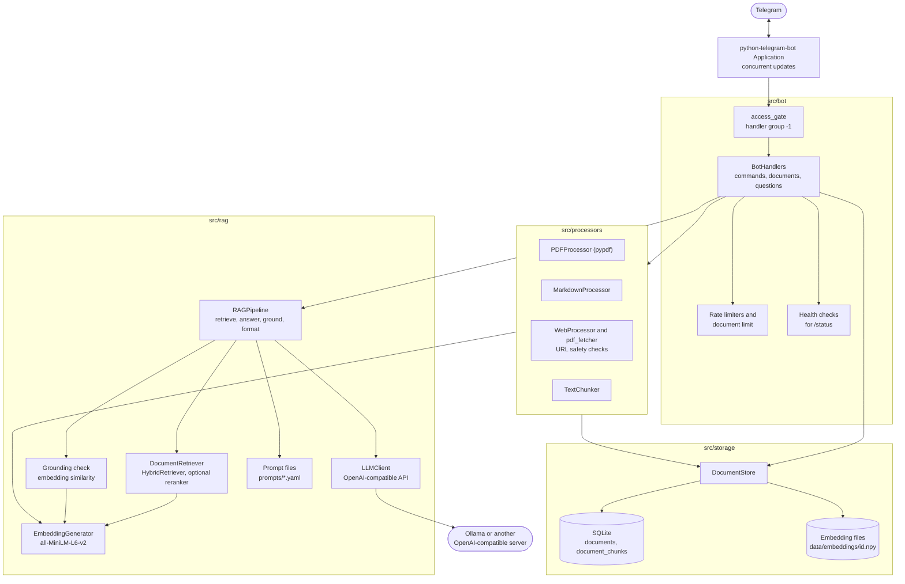
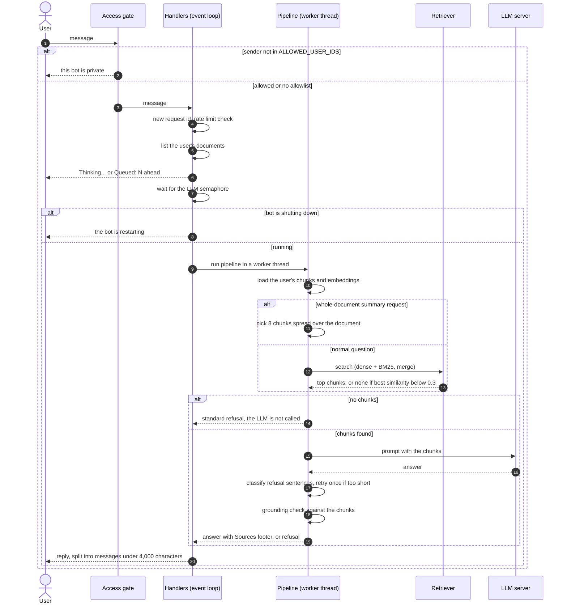

# TeleRAG architecture

This page describes how the parts of TeleRAG fit together: the components, what happens to a question, where data is stored, how several users are served at once, and the trade-offs. For setup see the [README](../README.md); for the reasons behind the choices see [design-decisions.md](design-decisions.md) and [INTERVIEW_NOTES.md](INTERVIEW_NOTES.md). All settings are listed in the README, so they are not repeated here.

## 1. Components



| Area | Files | Responsibility |
| :--- | :--- | :--- |
| Entry point | `main.py`, `src/startup.py`, `src/bot/application.py` | Read and check the settings, check the LLM server, build the application, start polling. |
| Settings | `src/config.py` | Read every setting, collect all problems, stop with one clear message. |
| Telegram layer | `src/bot/handlers/` | Commands, uploads, questions. Split into three mixins: `commands.py`, `documents.py`, `questions.py`. |
| Limits | `src/bot/rate_limiter.py` | Sliding-window limiter, one per kind of request. |
| Ingestion | `src/processors/` | Text extraction, chunking, safe downloading. |
| Retrieval | `src/rag/hybrid.py`, `retriever.py`, `reranker.py`, `embeddings.py` | Dense search, BM25, rank fusion, optional cross-encoder. |
| Answering | `src/rag/pipeline.py`, `llm_client.py`, `prompts.py` | The four pipeline steps, the LLM client, the prompt files. |
| Grounding | `src/rag/grounding.py` | Sentence splitting, refusal-sentence detection, similarity check. |
| Storage | `src/storage/` | SQLite access, embedding files, optional Chroma backend. |
| Logging | `src/logging_setup.py` | JSON log file with rotation, request IDs, secret redaction. |

The pipeline has four steps (`retrieve`, `abstain_or_generate`, `grounding`, `format_reply`). `ORCHESTRATOR=plain` calls them in order in plain Python. `ORCHESTRATOR=langgraph` runs the same functions as a LangGraph graph. Tests compare the two on the CI fixture.

## 2. What happens to a question



Details that are easy to forget:

- **Request ID.** A new ID is created at step 3 and stored in a context variable. It appears on every log line of this question, including lines written in the worker thread.
- **Blocking work leaves the event loop.** Embedding, PDF parsing, database access, URL checks and the LLM call all run through `asyncio.to_thread`. The event loop only handles Telegram traffic.
- **Reply formatting.** The text is HTML-escaped, code blocks are kept, long answers are split without breaking tags, and if Telegram rejects the HTML the bot sends plain text.
- **Uploads** follow a similar path: access check, rate limit, document limit, download or file transfer, extraction, chunking, embedding (with progress messages for large files), then storing.

## 3. Storage

```text
data/
├── documents.db            SQLite database
└── embeddings/
    ├── 1.npy               float32 array of shape (chunks, 384) for document 1
    └── 2.npy
logs/
└── bot.log                 JSON lines, rotated
```

Uploaded files are not stored. The bot keeps only the extracted chunks and their embeddings. (Older versions wrote one JSON file per chunk; the code still reads those if it finds them.)

**`documents`**: `id`, `user_id`, `filename`, `file_hash` (SHA-256 of the content), `file_size`, `chunk_count`, `upload_date`, `source_type` (`pdf`, `markdown`, `text`, `web`). `filename` is unique per user.

**`document_chunks`**: `id`, `document_id` (foreign key, `ON DELETE CASCADE`), `chunk_index`, `content`, `embedding_path` (unused by the default backend), `char_count`, `page`, `page_start`, `page_end`, `section_label`, `source_type`.

Every connection turns on `PRAGMA foreign_keys`, so deleting a document removes its chunks. A connection is opened for each operation and closed afterwards, which keeps threads from sharing connections.

`VECTOR_BACKEND=chroma` stores the vectors in ChromaDB instead (metadata still goes to SQLite). Chroma queries filter by `user_id`.

## 4. Caches and shared state

Everything that is shared between users or requests, and why it is safe:

| What | Scope | Why it is safe |
| :--- | :--- | :--- |
| BM25 index | Per `(user id, hash of the chunks)`, LRU with 8 entries, lock-protected | The key contains the user. `search()` keeps no state of its own. The user's entry is dropped when they add, delete or clear documents. |
| Embedding model | One per process | One thread encodes at a time (lock). |
| Cross-encoder model | One per model name | Loading and predicting are under locks. |
| Rate-limit counters | Per user, in memory | Only used from the event loop. Lost on restart. |
| LLM semaphore | One per process | Lets one question use the LLM at a time. |
| Request ID | Context variable | Each task has its own value, copied into worker threads. |

## 5. Concurrency and shutdown

- `concurrent_updates` (default 16) lets several Telegram updates run at once, so `/list`, uploads and other users are not blocked by a slow answer.
- The LLM semaphore (size 1) makes questions wait their turn. A CPU running a 3B model is fully used by one answer, so two at once would each take about twice as long. Users see `Queued: N ahead`.
- On Ctrl+C or SIGTERM, python-telegram-bot stops fetching updates and waits for the ones already running. Questions still waiting for the semaphore at that moment reply "the bot is restarting" instead of starting. A request that is already generating cannot be interrupted, so stopping can take up to `LLM_MAX_TOTAL_SECONDS`.
- Timeouts: Telegram calls 30 s; LLM calls 5 s to connect and `LLM_TIMEOUT_SECONDS` to read, with all attempts for one question limited by `LLM_MAX_TOTAL_SECONDS`; web pages 15 s per wait and 45 s in total; PDF links 30 s per wait and 60 s in total.

## 6. Trade-offs and limits

1. **One LLM answer at a time.** Protects the CPU and keeps each answer fast, but a busy bot means waiting. A faster machine or a hosted model (the client speaks the OpenAI chat API) is the way out.
2. **Brute-force vector search.** Simple and fast enough for thousands of chunks per user. Tens of thousands would need an approximate index.
3. **SQLite and local files.** No server to run, but one machine only, no encryption at rest, and heavy parallel writes would contend for the database file.
4. **Rate limits in memory.** Simple, but they reset when the bot restarts.
5. **Similarity-based checks.** Both the refusal threshold and the grounding check use cosine similarity. They are cheap and reduce bad answers, but they cannot tell a correct sentence from a wrong sentence on the same topic.
6. **URL checks have a DNS rebinding gap** (see the README).
7. **Reading chunks from disk per question.** Easy to reason about, slower than keeping vectors in memory.
